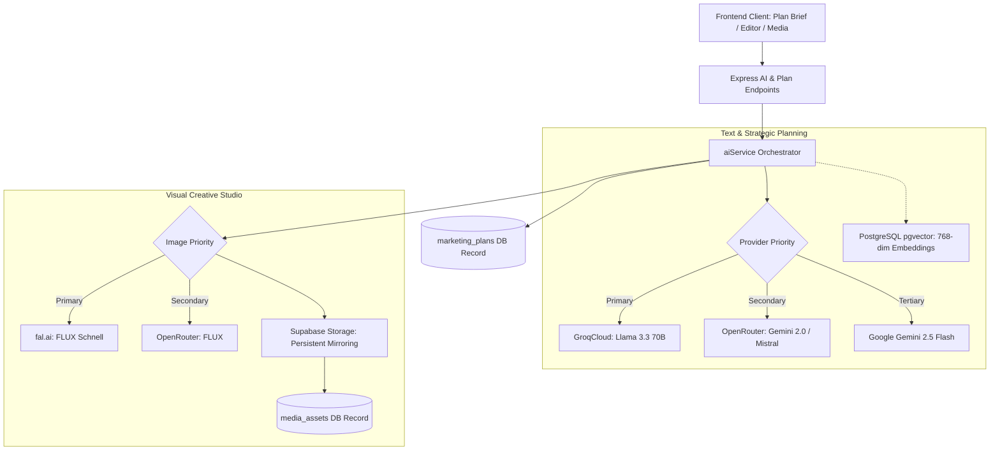

# AI Architecture

Pocket Agencom uses a resilient, provider-agnostic AI planning and creative production pipeline tailored for Vietnamese small businesses.

## Key Components

### 1. Multi-Provider Resilient Text & Planning Layer
- **GroqCloud (Primary)**: Ultra-low latency, highly cost-effective text generation for structured marketing plans, content expansion, and Vietnamese copywriting.
- **OpenRouter (Secondary Fallback)**: Multi-model flexibility and fallback resilience in case of GroqCloud rate limits or network degradation.
- **Google Gemini (Tertiary & Specialized)**: Multimodal vision post generation (analyzing product photos with design recommendations) and 768-dimensional embeddings for RAG strategy retrieval via `pgvector`.
- **Concurrency & Backoff**: Exponential backoff with jitter on 429/503 errors and a concurrency slot limiter prevent resource exhaustion.
- **Fail-Fast Policy**: Eliminates mock plan fallback strings. When all providers fail, an honest error status is reported to the client.

### 2. Social Media AI Image Generation Studio
- **Standard Aspect Ratios**: Fully supports `1:1` (Vuông - Feed Post), `4:5` (Dọc - Instagram/FB Post), `9:16` (Dọc - TikTok/Reels/Story), and `16:9` (Ngang - Cover/Blog/YouTube).
- **Interactive Visual Studio**:
  1. AI derives commercial visual prompts optimized for diffusion models from Vietnamese post text.
  2. Users can review, edit, and choose platform and visual style presets.
  3. Image generation is orchestrated via fal.ai FLUX (with OpenRouter fallback).
  4. Automatically downloads image buffers and mirrors them to Supabase Storage to avoid expiring CDN links.
  5. Records persistent `MediaAsset` entries and attaches them directly to scheduled posts or ideas.

### 3. Natural Language Plan Refinement Assistant
- `POST /api/marketing-plans/:id/refine` receives natural language user instructions and adjusts structured content ideas, scripts, checklists, and playbooks while preserving plan identity and ownership.

### 4. Non-AI Honest Data Layer
- Replaced all non-AI `Math.random` metric simulations across analytics, follower statistics, and ad spends with real recorded metrics and honest empty states.
