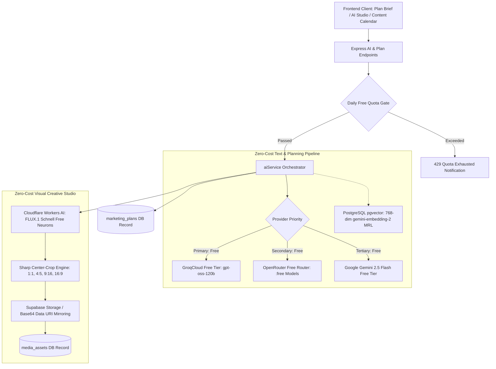

# AI Architecture (Strict Zero-Cost Free-Tier Guarantee)

Pocket Agencom operates on a strictly zero-cost ($0 budget) multi-provider AI architecture designed specifically for students and bootstrapped startups in Vietnam.

## Key Components

### 1. Strictly Free-Tier Enforcement ($0 AI Budget Guarantee)
- **`FREE_ONLY_MODE=true` & `AI_ALLOW_PAID_MODELS=false`**: When enabled, the orchestrator blocks all paid model endpoints, rejects unverified paid models, and ensures zero credit consumption.
- **Daily User Quotas**: Limits free usage to 50 text generations and 20 image generations per user per day (`AI_DAILY_TEXT_QUOTA_PER_USER=50`, `AI_DAILY_IMAGE_QUOTA_PER_USER=20`) to prevent abuse and API ban.
- **Clear Quota Reporting**: If free quotas or provider limits are reached, the API returns a transparent, actionable message instead of silently falling back to paid models or fake demo data.

### 2. Zero-Cost Text & Strategic Planning Stack
- **Primary — GroqCloud Free Tier**: Uses `openai/gpt-oss-120b` (replacing deprecated `llama-3.3-70b-versatile`). High throughput, low latency, and zero billing required.
- **Secondary Fallback — OpenRouter Free Router**: Configured with free models (e.g. `meta-llama/llama-3.3-70b-instruct:free` or `openrouter/free`). In free-only mode, paid OpenRouter models are strictly forbidden.
- **Tertiary & Multimodal — Google Gemini Free Tier**: `gemini-2.5-flash` or `gemini-2.0-flash` for vision analysis (evaluating uploaded product photos) and fallback copywriting.

### 3. Zero-Cost Image Generation via Cloudflare Workers AI
- **Cloudflare Workers AI**: Utilizes Cloudflare's free daily Neurons allocation running `@cf/black-forest-labs/flux-1-schnell`.
- **`sharp` Post-Processing Engine**: Cloudflare FLUX generates native 1024x1024 frames. The backend uses `sharp` to apply lossless center-crop extraction for standard social aspect ratios without distortion:
  - `1:1` (Vuông — Feed Post): 1024x1024
  - `4:5` (Dọc — Facebook/Instagram Feed): 896x1120
  - `9:16` (Dọc — TikTok/Story/Reels): 768x1344
  - `16:9` (Ngang — YouTube/Blog/Cover): 1344x768
- **Dual Storage Persistence**: Uploads generated images to Supabase Storage if configured; falls back gracefully to base64 Data URIs so local development requires zero external setup.
- **Post Attachment**: Image references persist inside scheduled post content (`[IMAGE_URL: ...]`) and `MediaAsset` records without database schema drift.

### 4. RAG Knowledge Base with `gemini-embedding-2` (MRL 768 Dimensions)
- **Model Migration**: Replaced deprecated `text-embedding-004` with Google's `gemini-embedding-2`.
- **Matryoshka Representation Learning (MRL)**: Configured with `outputDimensionality: 768` to align perfectly with PostgreSQL `vector(768)` columns.
- **Vector Space Isolation**: Stores `embeddingModel: 'gemini-embedding-2'` metadata and filters queries to prevent cosine similarity distortion against incompatible vector spaces.
- **Reindexing Utility**: Built-in `reindexKnowledgeBase()` safely upgrades historical vector entries.

### 5. Honest Data & Error Handling
- Never simulates AI output with mock templates or `Math.random`.
- Transient errors (429, timeouts, 503) trigger exponential backoff with jitter and respect `retry-after` response headers.
