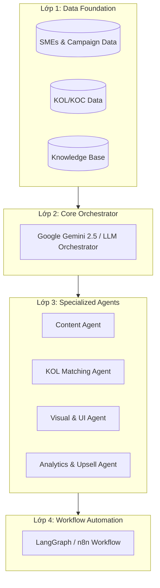

# Đề xuất Kiến trúc AI Hợp nhất: "Data-Driven Multi-Agent System"

Bản thiết kế hệ thống hợp nhất dưới đây vạch ra chính xác cách dữ liệu được sử dụng để nuôi dưỡng các AI Agents nhằm phục vụ tự động hóa và tối ưu hóa lợi nhuận cho chủ shop Micro-SME.

---

## 1. Kiến Trúc Hợp Nhất: "Data-Driven Multi-Agent System"

Hệ thống được chia thành 4 lớp (Layers) rõ ràng, lấy Dữ liệu (Dataset) làm móng và AI Agents làm lực lượng thực thi.

### Lớp 1: Data Foundation (Nền tảng Dữ liệu Hybrid)
- **SMEs & Campaign Data**: Dữ liệu về ngành hàng, ngân sách, mục tiêu chiến dịch, và kết quả ROI lịch sử.
- **KOL/KOC Data**: Tỉ lệ tương tác (engagement rate), giá booking, nhân khẩu học follower (độ tuổi, giới tính, khu vực địa lý lấy từ API TikTok/Instagram).
- **Knowledge Base**: Kho mẫu thiết kế Canva, Playbook "Nhi đồng hóa" (đơn giản hóa quy trình marketing), và Case study thực chiến.

### Lớp 2: Core Orchestrator (Não Điều Phối Trung Tâm)
- **Công nghệ**: Hiện tại sử dụng Google Gemini 2.5 Flash, hướng tới tích hợp thêm GPT-4o / Llama 3.1.
- **Nhiệm vụ**: Tiếp nhận yêu cầu ban đầu từ biểu mẫu `/marketing-kit`, phân tích thông tin đầu vào (ngân sách, ngành hàng, mục tiêu) và điều phối công việc cho các Agent chuyên biệt cấp dưới.

### Lớp 3: Specialized Agents (Lực lượng Thực thi Kỹ thuật số)
- **Content Agent**: Đọc dữ liệu Playbooks từ Database (qua RAG) để tự động sinh kịch bản chi tiết, caption, và checklist công việc dưới dạng "Fill-in-the-blank".
- **KOL Matching Agent (MỚI)**: Đọc dữ liệu từ KOL Dataset để chọn lọc và đề xuất top 3 Nano/Micro KOLs khớp với ngân sách của SME và có tỉ lệ ROI lịch sử tối ưu nhất.
- **Visual & UI Agent**: Gọi API Canva để tự động nhân bản và chỉnh sửa các mẫu thiết kế chuẩn hóa theo ngành hàng.
- **Analytics & Upsell Agent**: Theo dõi hành vi sử dụng của chủ shop trên Dashboard. Nếu hệ thống phát hiện hiệu quả chiến dịch tự làm chưa đạt hoặc khách hàng gặp khó khăn, Agent sẽ dựa vào Campaign Data để đề xuất các gói dịch vụ nâng cao (DFY - Do It For You) đi kèm thông điệp thuyết phục: *"Gói Upsell này có lịch sử đem lại ROI 300% cho các tiệm Nails có quy mô tương tự."*

### Lớp 4: Workflow Automation (Hệ thống Tự động hóa)
- Sử dụng **LangGraph** hoặc **n8n** để kết nối toàn bộ quy trình của các Agent: Nhận form -> Matching KOL -> Viết Content -> Đóng gói PDF/Dashboard -> Gửi thông báo Zalo ZNS cho khách hàng.

---

## 2. Sự Khớp Nối Hoàn Hảo Giữa Data và AI Agents

Để ngăn chặn tối đa hiện tượng ảo tưởng (Hallucination) của AI, mỗi Agent sẽ được cấp quyền truy cập vào phân vùng dữ liệu tương ứng:

| AI Agent | Nguồn Dữ Liệu Nuôi Dưỡng (Dataset) | Kết Quả Đầu Ra (Output) |
| :--- | :--- | :--- |
| **Content Agent** | RAG từ Knowledge Base (Case studies, Playbooks mẫu). | Kịch bản video tiếng Việt chi tiết, Checklist hành động chuẩn xác. |
| **KOL Matching Agent** | KOL Features (Giá, Niche, Tỷ lệ tương tác, Demographics). | Danh sách đề xuất KOL khả thi, dự toán chi phí chính xác. |
| **Strategy Agent** | Lịch sử chiến dịch (Phân bổ ngân sách, Dữ liệu doanh thu bán hàng). | Đề xuất phân bổ ngân sách tối ưu (Ví dụ: 30% Ads, 70% KOL). |
| **QC Agent** | Lịch sử chiến dịch (Campaign History & Tiêu chuẩn định dạng). | Duyệt tự động kịch bản của Freelancer xem có chuẩn định dạng và quy định nhãn hàng không. |

---

## 3. Lộ Trình Triển Khai Hợp Nhất (Lean Implementation)

Lộ trình tích hợp kết hợp song song việc thu thập dữ liệu (mất nhiều thời gian) và phát triển tính năng AI để tối ưu hóa dòng tiền:

| Giai đoạn | Giải pháp AI | Tích lũy Dữ liệu (Data) | Mục tiêu Doanh thu & Vận hành |
| :--- | :--- | :--- | :--- |
| **Giai đoạn 1: MVP (Đang thực hiện)** | Single LLM (Gemini 2.5 Flash API) + Prompt Engineering cấu trúc JSON chặt chẽ. | RAG cơ bản chứa các Playbook và Template do đội ngũ Marketing nội bộ soạn thảo. | Chứng minh sản phẩm chạy mượt, giao diện UI/UX tốt, thu hút khách hàng trải nghiệm gói DIY (199k). |
| **Giai đoạn 2: Version 1.0 (3 - 6 tháng tới)** | Áp dụng LangChain/LangGraph vào Backend để chia nhỏ task. Xây dựng Content Agent & Visual Agent (kết nối API Canva). | Chạy Script thu thập (Scraping/API) dữ liệu KOL TikTok/Instagram nạp vào DB. Lưu vết lịch sử chiến dịch của khách hàng MVP. | Ra mắt tính năng Gợi ý KOL tự động, tăng mạnh tỉ lệ chuyển đổi chốt gói DWY (Do With You - 890k). |
| **Giai đoạn 3: Scale (Năm 2026)** | Multi-Agent hoàn chỉnh. Tích hợp mô hình dự đoán (Predictive ML như XGBoost) kết hợp GenAI. | Sở hữu tập dữ liệu đủ lớn (hàng ngàn chiến dịch) để chạy thuật toán hồi quy dự đoán doanh số bán hàng (Sales Prediction). | Hệ thống tự động hóa 90%. Bán các gói dịch vụ giá trị cao (High-ticket) kèm cam kết tỉ lệ chuyển đổi dựa trên dữ liệu lịch sử. |

---

## 4. Giá Trị Cốt Lõi Tác Động Đến Business Model Canvas

Bản kiến trúc này giải quyết triệt để bài toán kinh doanh của dự án:

1. **Loại bỏ Nút Thắt Cổ Chai (Bottleneck)**: Đội ngũ nội bộ không bị quá tải khi thực hiện Upsell. AI (QC Agent) sẽ đóng vai trò quản lý và kiểm duyệt tự động chất lượng đầu ra của mạng lưới Freelancer thay con người.
2. **Rào Cản Gia Nhập (Moat)**: Đối thủ cạnh tranh có thể sao chép giao diện Web hay gọi cùng API Gemini giống bạn. Tuy nhiên, họ không thể sao chép bộ dữ liệu hỗn hợp **"Hybrid Dataset + RAG"** tích lũy từ lịch sử hàng ngàn chiến dịch thành công tại Việt Nam của bạn. Đây chính là tài sản vô giá tạo nên vị thế dẫn đầu.
