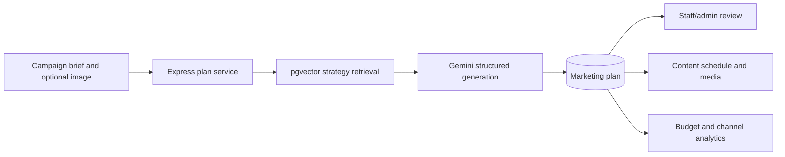

# AI Architecture

Pocket Agencom uses a focused AI planning pipeline for Vietnamese small businesses.

The plan service combines business profile context, the campaign brief, existing resources, deployment channels, and relevant knowledge-base strategies. Gemini returns structured content ideas, scripts, checklists, playbooks, SEO keywords, and a channel-aware budget breakdown. The original generated fields are persisted so historical plans remain auditable.

Text generation and image-aware generation are separate calls. Uploaded campaign assets are persisted through the storage service, while embeddings and similarity search use PostgreSQL pgvector. Retrieval failures return no context; external AI verification must assert the provider response and persistence rather than treating local fallback copy as a successful Gemini check.

Secrets remain server-side. Production validation should cover response shape, ownership checks, persistence, review transitions, embedding dimensions, and retrieval relevance without asserting exact generated wording.
